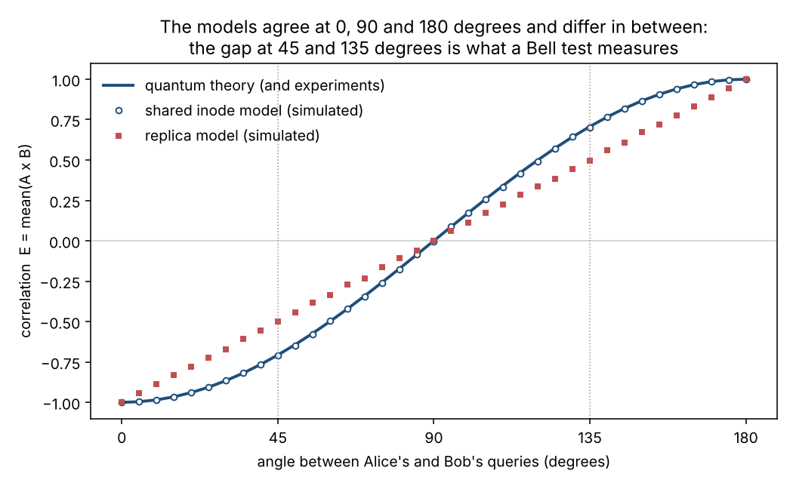
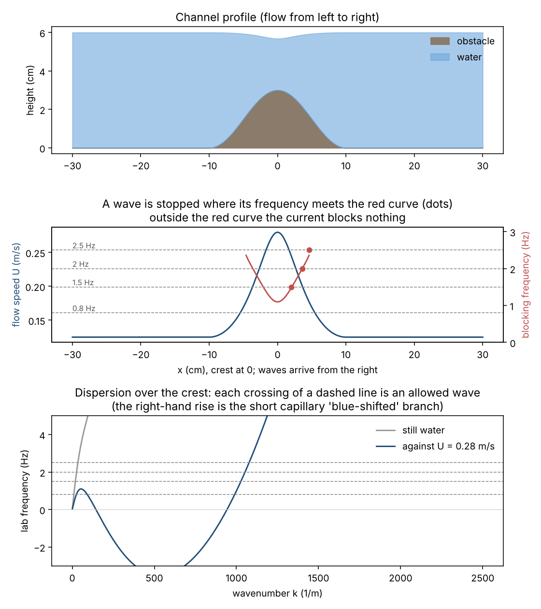

# Universal Data Lake (UDL)

*A speculative information-based picture of physical reality, with honest critique, a simulation and a tabletop experiment.*

by **Vitalii Buchyn**

🇺🇦 [Українська версія](README.uk.md)

> **Status: a hypothesis, not a theory.** UDL is a way of looking at known physics through data-engineering metaphors. It is consistent with the experiments discussed here, but it does not yet make a prediction that standard physics doesn't. The repository says plainly where it is strong, where it breaks, and what would refute it.

## The idea in six lines

1. **Space is information**: a passive, unstructured store we call the *Universal Data Lake*.
2. **What we observe is the lake being read.** Like *schema-on-read*, structure appears only when data is queried; in physics, the query is an interaction or a measurement. Quantum discreteness is what reading looks like.
3. **Superposition is one record with several weighted hard links**: one inode, several addresses, no copies.
4. **Entanglement is one inode linked from two distant places.** The first read commits a random value; the other link then resolves against it.
5. **Gravity is a property of the lake itself**, not of the data read from it.
6. **So quantizing gravity may be the wrong question**: there may be nothing to quantize.

Read the full statement in [`docs/01-hypothesis.md`](docs/01-hypothesis.md).

## What's here

| | |
|---|---|
| [`docs/01-hypothesis.md`](docs/01-hypothesis.md) | The claims, numbered, with what each one adds |
| [`docs/02-dictionary.md`](docs/02-dictionary.md) | UDL terms ↔ physics terms |
| [`docs/03-superposition-and-entanglement.md`](docs/03-superposition-and-entanglement.md) | Inodes, hard links, commits, and why "copy" and "replica" fail |
| [`docs/04-gravity.md`](docs/04-gravity.md) | Gravity as a property of the substrate; related serious work |
| [`docs/05-open-problems.md`](docs/05-open-problems.md) | Where the idea is weak or unfinished |
| [`docs/06-how-to-refute-it.md`](docs/06-how-to-refute-it.md) | Experiments that could prove it wrong |
| [`docs/references.md`](docs/references.md) | Papers cited |
| [`docs/linkedin-post.md`](docs/linkedin-post.md) | Short public write-ups |
| [`simulations/bell/`](simulations/bell/) | **Simulation:** a "replica" and a "shared inode" model of an entangled pair, put through a Bell test |
| [`experiments/water-horizon/`](experiments/water-horizon/) | **Experiment:** a tabletop analogue event horizon in a water channel |

## Simulation: replica vs. shared inode

If entangled particles were *replicas* (each carrying answers written in advance), Bell's theorem limits their correlations to |S| ≤ 2. Experiments see 2.83. The *shared inode* model, where nothing is stored in advance and the first read commits a random value, reproduces 2.83, never lets Bob see what Alice did, and gives the same results whoever reads first.



```bash
pip install -r requirements.txt
python simulations/bell/udl_bell.py --plot bell.png
```

## Experiment: a horizon in a water channel

Waves sent upstream against a current that speeds up over a bump are stopped at a point, a *white hole horizon*, with the same mathematics as a gravitational one. This shows the intuition behind UDL in the lab: **a medium can behave like spacetime.** It does not test UDL itself. Build guide, prediction code and video analysis are in [`experiments/water-horizon/`](experiments/water-horizon/).



## Tests

```bash
pytest -q
```

They also run on every push through GitHub Actions.

## Contributing

Critique is the most useful contribution. If you see a place where UDL contradicts an experiment, or a known theory it simply renames, open an issue. Builders of the water channel: please share your dimensions, flow rate and a short video.

## Author

**Vitalii Buchyn** · [LinkedIn](https://www.linkedin.com/in/vitalii-buchyn-88087824/) · visionregion@gmail.com

To cite this work, use the *Cite this repository* button on GitHub (from [`CITATION.cff`](CITATION.cff)).

## License

Code: MIT. Text and figures: CC BY 4.0. See [`LICENSE`](LICENSE).
