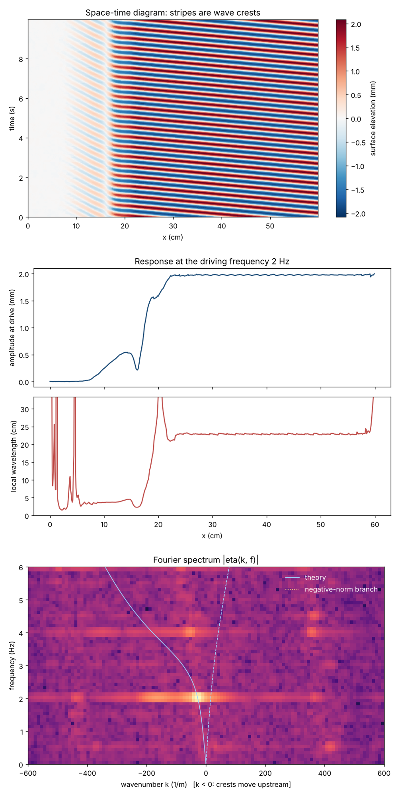

# Water Horizon

Part of the [Universal Data Lake](../../README.md) project.

**A tabletop analogue of an event horizon, built from a water channel, a pump and a smartphone.**

Surface waves are sent upstream against a current that speeds up over a smooth bump on the channel floor. Where the current becomes as fast as the waves can travel, they stop: the bump acts as a *white hole*, a region waves cannot enter. This is the same mathematics as a gravitational horizon, reproduced in a fluid. Experiments of this kind were pioneered by Unruh (1981) and carried out in research flumes in Nice, Vancouver and Poitiers.

This repository contains everything needed to build a home-scale version, predict where the horizon will form, and measure it from video.

> **Status:** design and analysis tools are ready and tested on synthetic data. The physical experiment has not been run yet. Results, photos and data will be added in [`data/`](data/).


*Prediction for the reference setup (6 cm deep, 8 cm wide, 0.6 L/s, 3 cm bump): waves at 1.5–2.5 Hz are stopped 2–5 cm downstream of the crest; waves below ~1.1 Hz pass over.*

## Why

This project grew out of a speculative idea I call the **[Universal Data Lake (UDL)](../../docs/01-hypothesis.md)**: that space is a passive information substrate, that what we observe as quantum, discrete physics is information being *read* from it, and that gravity is a property of the substrate itself rather than a force that needs to be quantized.

A water channel cannot test that idea. What it *can* do is show, hands-on, the core intuition behind it: **a medium can behave like spacetime.** Horizons, frequency shifts and an analogue of Hawking mode conversion emerge from nothing but flowing water. That is the research field of *analogue gravity*, and it is real, peer-reviewed physics. See [`docs/PHYSICS.md`](docs/PHYSICS.md) for the analogy, and for what it does and does not show.

## What you will see

| Observation | Gravity analogue |
|---|---|
| A wave slows down and piles up just before the bump, then disappears | Horizon: nothing gets in |
| Its wavelength shrinks sharply as it approaches | Blue-shift near a horizon |
| Short ripples appear and are swept back downstream | Mode conversion, the classical relative of Hawking radiation |
| The stopping point moves when you change the frequency | Dispersive horizon: each frequency has its own horizon |

## Repository layout

```
analysis/
  horizon.py               predict depth, speed and horizon position over the bump
  surface_from_video.py    extract the water surface from a side-view video and analyse it
  make_synthetic_video.py  generate a test video with known waves
wavemaker/
  wavemaker.ino            Arduino sketch: servo-driven sinusoidal wave maker
docs/
  BUILD.md                 parts list and construction
  PROCEDURE.md             step-by-step measurement protocol
  PHYSICS.md               how and why it works, references
data/                      measurements go here (one folder per run)
tests/                     end-to-end check of the analysis pipeline
```

## Quick start

```bash
pip install -r ../../requirements.txt   # from the repository root
cd analysis

# 1. Will my channel make a horizon?
python horizon.py --depth 0.06 --width 0.08 --flow 0.6 \
                  --bump-height 0.03 --bump-length 0.20 \
                  --freq 0.8 1.5 2 2.5 --plot ../docs/reference_setup.png

# 2. Try the video analysis on a synthetic video before filming anything
python make_synthetic_video.py --out synthetic.mp4
python surface_from_video.py synthetic.mp4 --px-per-cm 10 --roi 0 100 600 300 \
       --drive-freq 2 --overlay-speed 0.12 --overlay-depth 0.06 --out results/synthetic
```

The synthetic video contains a 2 Hz wave of 2 mm travelling upstream, fading out over a "horizon" zone and partly converting into shorter waves. The analysis recovers the amplitude within 2% and the wavelength within 1% of the input:



Run `pytest -q` from the repository root to repeat these checks; they also run on every push via GitHub Actions.

Then follow [`docs/BUILD.md`](docs/BUILD.md) and [`docs/PROCEDURE.md`](docs/PROCEDURE.md).

## Safety

A mains-powered pump in water is the one real hazard here. Use a pump rated for submersion, plug it into an outlet protected by a **30 mA RCD/GFCI**, keep every plug and power supply above the water level with a drip loop, and never touch the water with the pump running if any cable is damaged. A 12 V DC pump avoids the problem entirely. The wave maker runs on low voltage; keep the Arduino and servo supply dry anyway.

## Contributing

Built one? Open an issue or pull request with your channel dimensions, flow rate, a short video and the output of `horizon.py`. Comparing many home builds against the prediction is the most useful thing this repository could produce.

## License

Code: MIT. Documentation and figures: CC BY 4.0. See [`LICENSE`](../../LICENSE).
